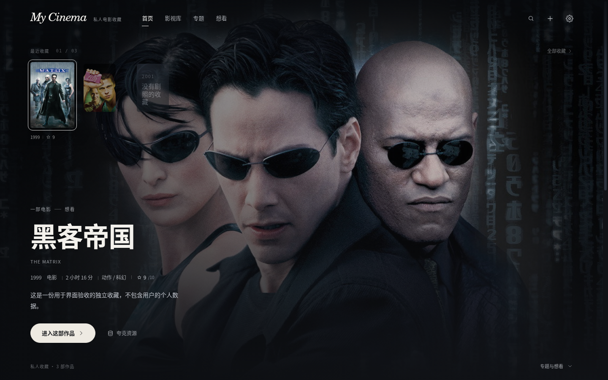

# My Cinema

一座属于自己的私人影视收藏馆。以 PS5 式沉浸浏览和电影杂志排版，整理电影、剧集与观影记忆。



[更多界面预览](docs/GALLERY.md)

## 能做什么

- 横向海报浏览，背景与焦点联动。
- 收藏、评分、观看状态、短评与自定义专题。
- TMDB 搜索导入，海报和背景图本地缓存。
- 夸克资源记录、指定云端目录清单读取。
- SQLite 本地保存，支持备份、恢复与 JSON 导出。

面向 Windows 10 / 11 x64 个人使用，不提供播放或下载功能。夸克真实账号接入、TMDB 在线完整链路及 Windows 桌面验收状态见[验证说明](docs/VERIFICATION.md)。

## 开始使用

安装与首次配置见[使用指南](docs/USAGE.md)。从源码开发需要 Node.js 22+ 和 pnpm 11：

```bash
pnpm install
pnpm dev
```

构建、测试和 Windows 打包见[开发指南](docs/DEVELOPMENT.md)。

## 文档

- [使用指南](docs/USAGE.md)：安装、TMDB 配置、数据备份与快捷键。
- [夸克目录接入](docs/QUARK-FOLDERS.md)：官方授权方式、配置与实现边界。
- [视觉与交互](docs/DESIGN.md)：布局、字体、动效与可访问性。
- [架构说明](docs/ARCHITECTURE.md)：Electron、数据层与安全模型。
- [验证说明](docs/VERIFICATION.md) · [故障排查](docs/TROUBLESHOOTING.md) · [修复记录](docs/REPAIRS-2026-10-24.md)。
- [全部文档](docs/README.md)。

个人非商业项目。影视资料与图片来自 TMDB；本产品未获得 TMDB 的认可或认证。
