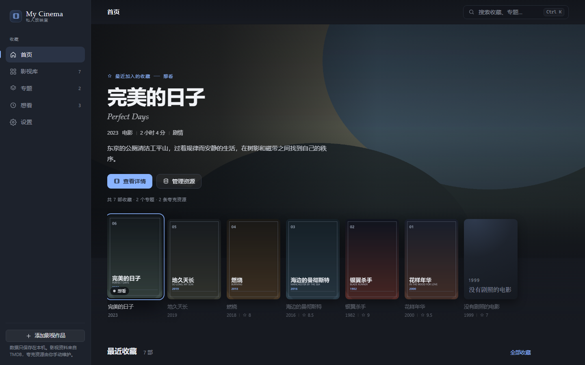
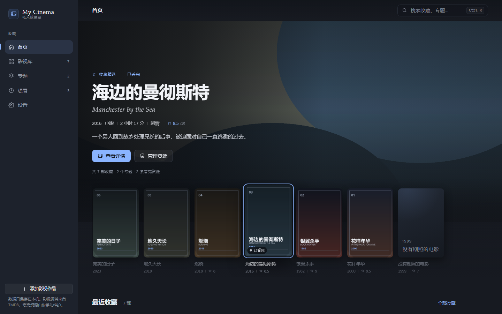
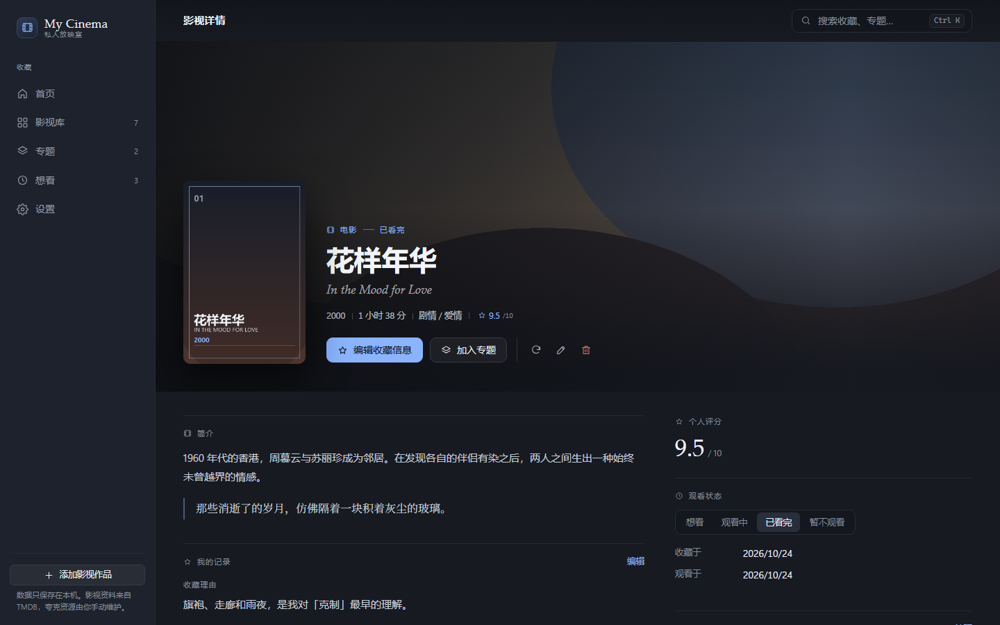
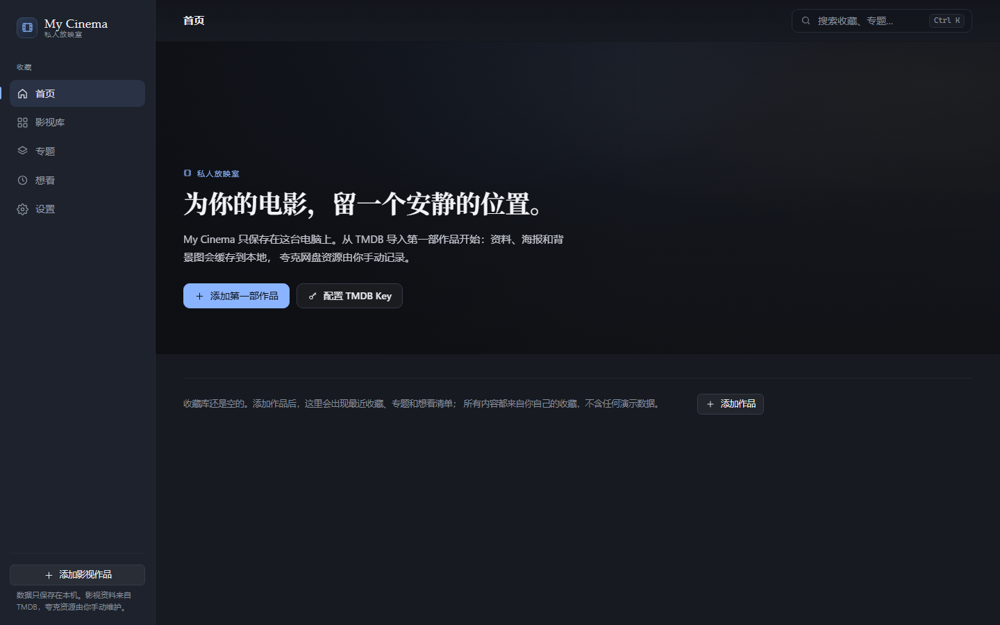

# My Cinema

一个只在自己的 Windows 电脑上运行的私人影视收藏库：用电影杂志式的界面整理收藏、专题与观影记录，并记录夸克网盘中的资源位置。

它**不是**播放器、下载器或网盘客户端。应用不登录夸克、不读取 Cookie、不解析分享链接、不检测链接是否有效，也不访问你的网盘内容。



---

## 一、功能范围

| 模块 | 已实现 |
|---|---|
| 收藏库 | 添加（TMDB 搜索导入 / 手动录入）、编辑资料、编辑收藏信息、移除收藏 |
| 个人数据 | 评分（0–10）、观看状态（想看 / 观看中 / 已看完 / 暂不观看）、收藏时间、观看时间、收藏理由、个人短评 |
| 专题 | 创建、重命名、描述、删除、加入 / 移除作品；一部作品可属于多个专题 |
| 夸克资源 | 同一作品多条资源、分享链接、提取码、清晰度 / 版本 / 字幕 / 音轨备注、复制链接、用系统浏览器打开、资源状态 |
| 检索 | 标题 / 原名 / 简介 / 笔记全文搜索，年份、状态、专题筛选，7 种排序 |
| 数据 | SQLite 本地持久化、版本化迁移、数据库备份 / 恢复、JSON 导出 |
| 桌面 | 窗口尺寸与位置记忆、系统浏览器打开链接、应用图标、NSIS 安装包 |

已明确**不做**：其他网盘、夸克账号登录、Cookie 读取、未公开接口调用、链接有效性自动检测、网盘播放 / 下载、本地媒体扫描、账号系统、云同步。

---

## 二、视觉与交互

视觉方向是 **PS5 式沉浸浏览 + 电影杂志排版**，而不是通用管理后台。

**首页（沉浸式主视觉 + 聚焦轨道）**

- 全幅背景图铺满内容区（1280 / 1440 / 1920 下均贴边），左侧渐变遮罩保证文字可读，右侧保留画面。
- 主视觉下方是一条横向**聚焦轨道**：鼠标悬停或键盘方向键切换选中项时，背景图交叉淡入、标题 / 原名 / 年份 / 时长 / 评分 / 简介同步更新，页面不发生重排。
- 选中海报抬升 6px、放大 1.03 倍、冰蓝轮廓，未选中项降低对比；状态标签仅在悬停 / 选中时出现。
- 背景切换只使用本地缓存（`mycinema://`），切换前预解码目标图，避免闪烁与重复请求；减少动效时改为直接切换。
- 无收藏时展示排版式空状态与两个真实入口（添加作品、配置 TMDB Key），不伪造任何数据。

**详情页（电影主视觉优先）**

- 顶部大幅背景图 + 海报 + 标题叠加在渐变上，主操作只有两个（编辑收藏信息、加入专题），其余（刷新资料 / 编辑资料 / 移除）收敛为图标按钮。
- 下方以细分隔线组织简介、我的记录、夸克资源；右侧为评分、观看状态、专题与资料信息，不使用厚重卡片容器。

**导航与材质**：侧边栏保留但退居背景；顶栏去掉边框；卡片默认无边框，靠背景层次与阴影区分；控件只使用一处冰蓝强调（选中、焦点、主操作）。

| | |
|---|---|
|  |  |
|  |  |

---

## 三、技术选型

| 层 | 选择 | 理由 |
|---|---|---|
| 桌面外壳 | **Electron 45** | 本机没有 Rust / Cargo 工具链，Tauri 需要先安装整条 Rust 工具链才能产出安装包；Electron 可以直接交付可运行的 Windows 应用与安装包 |
| UI | React 19 + TypeScript + Vite 7 | 组件化、类型安全、构建快；样式用原生 CSS + 设计令牌，不引入 UI 框架 |
| 数据库 | SQLite via `better-sqlite3` 13 | 单文件、事务完整、同步 API 适合主进程；该版本提供 **N-API 预编译二进制**，无需按 Electron ABI 重新编译 |
| 进程模型 | 主进程持有数据与网络，渲染进程只做 UI | `contextIsolation: true`、`nodeIntegration: false`、`sandbox: true`，渲染进程无法直接执行 SQL 或任意系统命令 |
| 凭据 | Electron `safeStorage`（Windows DPAPI） | API Key 加密后存本地文件，不进入数据库、导出文件与日志 |
| 测试 | Vitest（数据 / 服务 / 网络层）+ 无头浏览器截图 | 业务逻辑可脱离 Electron 测试；界面用真实构建产物渲染验证 |

> 没有为「以后可能支持别的网盘」预留插件层，也没有为单机应用引入账号、同步或云数据库。

---

## 四、环境要求

- Windows 10 / 11（x64）
- Node.js ≥ 22（开发与构建时；应用本身由 Electron 自带运行时）
- pnpm 11（仓库使用 hoisted `node_modules`，见 `.npmrc`）

---

## 五、安装、开发与构建

```powershell
# 1. 安装依赖
pnpm install

# 2. 首次安装若 Electron 二进制未下载（网络受限时），使用可续传脚本：
node scripts/fetch-electron.mjs

# 3. 开发模式（Vite HMR + 主进程热重启）
pnpm dev

# 4. 类型检查 + 构建（dist-electron/ + dist/）
pnpm build

# 5. 自动化测试
pnpm test

# 6. 直接运行已构建版本
pnpm start:prod

# 7. 生成 Windows 安装包（release/）
pnpm package
```

### 网络受限时的说明

- `pnpm install` 会从 npm registry 取包；Electron 二进制默认从 GitHub 下载。若失败，`node scripts/fetch-electron.mjs` 会按 4 MB 分块续传（默认使用 npmmirror 镜像，失败再回退 GitHub），并解压到 `node_modules/electron/dist`。
- 打包时 electron-builder 需要 NSIS 等工具与 Electron 压缩包。若 `github.com` 不可达（本机曾出现被解析到 `127.0.0.1` 的情况），可把 `electron-v45.0.0-win32-x64.zip` 放到 `.eb-cache/electron/` 再打包，或设置 `ELECTRON_MIRROR=https://registry.npmmirror.com/-/binary/electron/` 与 `ELECTRON_CUSTOM_DIR={{ version }}`。
- `pnpm package` / `pnpm package:dir` 走 `scripts/package.mjs`：它会把 `TMP`/`TEMP` 指到项目内 `.tmp`、把 `.tools` 加进 PATH、补齐 builder 缓存与镜像，因此不再需要手工导出环境变量。

### 安装与故障排查

- **最简单的方式**：双击 `release\INSTALL.cmd`。
  它把临时目录放在安装包旁边（`release\mc-temp`），先写探针确认可写，再直接调用安装器；窗口会保留并打印退出码，不会一闪而过。
- **完全跳过安装器**：双击 `release\RUN-PORTABLE.cmd`，解压到 `release\portable\` 并启动；或手动解压
  `release\My-Cinema-1.0.0-portable-win64.zip`。与安装版共用同一份 userData。
- 命令行等价物：`pnpm install:app` / `pnpm run:portable` / `pnpm doctor`。
- 安装包本体：`release\My-Cinema-1.0.0-Setup.exe`（直接双击可能受系统临时目录影响），按用户安装、不请求管理员权限。
- 应用本身已把 Chromium 的临时文件放进 `%APPDATA%\My Cinema\tmp`，因此系统 TEMP 有问题时应用仍可运行，只有安装器 / 卸载程序（均为 NSIS）受影响。卸载请用「设置 → 应用」或控制面板。
- 其它问题见 [docs/TROUBLESHOOTING.md](docs/TROUBLESHOOTING.md)。

### 已验证的构建产物

| 产物 | 路径 | 大小 | 说明 |
|---|---|---|---|
| Windows 安装包 | `release/My-Cinema-1.0.0-Setup.exe` | 115.59 MB | NSIS，按用户安装、不请求管理员权限；SHA-256 `8621E609…2E9B` |
| 免安装版 | `release/My-Cinema-1.0.0-portable-win64.zip` | 161.83 MB | 解压即用，不经过安装器；SHA-256 `1B41B233…E209` |
| 免安装目录 | `release/win-unpacked/` | 383.7 MB / 139 文件 | 启动文件 `My Cinema.exe` |
| 渲染层 | `dist/` | 约 380 KB | `index.html` + `assets/index-*.js/css` |
| 主进程 / preload | `dist-electron/` | 111 KB / 3 KB | CJS bundle |
| 应用图标 | `build/icon.ico` | 7 个尺寸（16–256） | 由 `scripts/make-icon.py` 生成 |

安装包内已确认包含 `dist`、`dist-electron` 与 `app.asar.unpacked/node_modules/better-sqlite3/prebuilds/win32-x64.node`。

---

## 六、数据存放与安全

所有可变数据位于 Electron 的 `userData` 目录（默认 `%APPDATA%\My Cinema`），**升级应用不会清理数据**：

```
%APPDATA%\My Cinema\
├─ library.db            SQLite 数据库（影视资料 / 收藏 / 专题 / 夸克资源 / 设置）
├─ library.db-wal        WAL 日志
├─ images\               海报与背景图缓存（数据库只存相对路径）
│  ├─ poster\<2位散列>\<sha1>.png
│  └─ backdrop\...
├─ backups\              手动备份与恢复前的自动快照（pre-restore-*.db）
├─ exports\              JSON 导出
├─ logs\app.log          运行日志（已脱敏，滚动 2 MB）
├─ credentials.json      safeStorage 加密后的 TMDB API Key
└─ window-state.json     窗口尺寸 / 位置
```

- 卸载程序**不会**删除上述目录（`deleteAppDataOnUninstall: false`）。需要彻底清除时请手动删除该目录。
- 图片缓存丢失不影响收藏：数据库只保存相对路径，界面会自动回退为排版式占位图，重新获取元数据即可再次缓存。
- 备份可用 `VACUUM INTO` 生成一致性快照；恢复前会自动把当前数据库另存为 `pre-restore-*.db`，恢复失败自动回滚。
- 日志中的 API Key、JWT、`?pwd=` / `access_code=` 参数以及已登记的提取码都会被替换为 `[redacted]`。

### 数据库结构（schema v2）

`films` · `collection_entries` · `collections` · `collection_films` · `media_resources` · `app_settings` · `schema_migrations`

关键约束：

- `collection_entries.film_id` **UNIQUE**（一部作品在收藏库中只有一个条目）
- `films (metadata_source, external_id)` 部分唯一索引（重复导入检测）
- `collection_films (collection_id, collection_entry_id)` 复合主键（专题内不重复）
- 外键 `ON DELETE CASCADE`：删除作品会清理其收藏条目、专题关联与资源；删除专题或资源**不会**影响作品

迁移在事务内执行，并在 `schema_migrations` 记录版本；遇到比应用更新的 database schema 会拒绝打开而不是覆盖。

---

## 七、TMDB 元数据

1. 到 <https://www.themoviedb.org/settings/api> 免费申请 API Key（v3 Key 或 v4 读取令牌均可）。
2. 应用内「设置 → 影视元数据」粘贴 Key，点「保存并验证」——会真实请求一次 TMDB 后才保存。
3. 「添加影视作品 → 搜索 TMDB」输入片名，从真实结果中挑选，确认后才会写入本地。

实现要点：

- 请求地址优先 `https://api.tmdb.org/3`，失败自动回退 `https://api.themoviedb.org/3`（部分网络只放行其一）。
- 超时 12 秒；401 → Key 无效；429 → 限流；404 → 无此资料；网络错误与超时分别给出中文提示。
- 中文简介为空时自动回退一次英文，避免详情页空白。
- 导入时同步下载海报（w500）与背景图（w1280）到本地缓存；**下载失败不会导致导入失败**，界面会提示「图片未能缓存」。
- 「刷新 TMDB 资料」只更新外部字段与图片，评分、笔记、收藏理由、专题、夸克资源都不受影响。

本产品使用 TMDB API，但未获得 TMDB 的认可或认证。

> 本机网络对 `api.themoviedb.org` 做了 DNS 污染，`api.tmdb.org` 与 `image.tmdb.org` 可正常访问；这也是应用内置双域名回退的原因之一。

---

## 八、夸克资源

只保存你手动填写的信息：资源名称、分享链接（http/https）、可选提取码、清晰度 / 版本 / 字幕 / 音轨、备注、状态（未检查 / 可用 / 不可用）。

- 应用**不会**访问、解析、下载或验证链接，也不会自动把状态标成「可用」。
- 「复制链接」写入剪贴板；「打开」经协议校验后交给系统默认浏览器。
- 删除一条资源只删除该记录，作品与收藏条目保持不动。

---

## 九、快捷键

| 快捷键 | 行为 |
|---|---|
| `Ctrl K` | 打开 / 关闭全局搜索（作品 + 页面跳转，支持 ↑↓、Enter） |
| `Ctrl F` | 跳转影视库并聚焦搜索框（在输入框内不抢占） |
| `Ctrl I` | 打开「添加影视作品」（在输入框内不抢占） |
| `Esc` | 关闭弹窗、搜索面板 |
| `Tab` / `Enter` | 在弹窗内循环焦点；Enter 激活当前操作 |

---

## 十、测试与验证

```powershell
pnpm test          # 49 个用例
pnpm typecheck     # tsc --noEmit
pnpm build         # 类型检查 + 打包主进程 + 构建渲染层
```

覆盖的业务场景（`tests/`）：

1. 收藏新增 / 编辑 / 删除
2. 外部元数据与个人评分、笔记、资源隔离
3. 专题新增 / 编辑 / 删除
4. 一部作品加入多个专题（且重复加入幂等）
5. 一部作品关联多条夸克资源
6. 删除资源不删除收藏
7. 重启后仍可读取（关库 → 重开同一文件）
8. 备份 / 恢复 / JSON 导出，以及非法备份文件被拒绝且不破坏现有数据
9. 重复导入检测（同一 TMDB id 不产生第二条收藏）
10. 搜索无结果、401、429、超时、镜像不可达的错误映射
11. 图片下载失败仍可完成导入；同名 URL 只下载一次；拒绝目录穿越路径
12. 非 http/https 链接、超长提取码、越界评分被拒绝
13. API Key / 提取码 / JWT 不出现在日志
14. 搜索、年份 / 状态 / 专题筛选、年份与评分排序、`%` 与 `_` 转义
15. 1280 / 1440 / 1920 三档宽度下的界面检查（见下）

### 界面验证方式（重要）

本机无法创建 Electron 窗口：`electron.exe` 在 `BrowserWindow` 创建阶段直接崩溃（`STATUS_BREAKPOINT` / `ACCESS_VIOLATION`，加 `--no-sandbox`、`--disable-gpu`、`--single-process` 均无效），而以 Node 方式运行 `electron --version` 正常。因此界面验证改由 `scripts/ui-harness.ts` 完成：

- 用**真实的**数据层与服务层（同一个 `openLibraryDatabase` / `LibraryService` / `ImageCache`）在临时目录建库、导入作品、建专题、加资源；
- 通过 HTTP 提供**真实的** `dist/` 构建产物（React 组件与 CSS 与发行版一致），用一个极薄的 `window.cinema` 适配层替代 preload 传输；
- 用无头 Edge（Chromium 同源）在 1440×900 / 1280×800 / 1920×1080 下截图。

```powershell
node scripts/run-ui-harness.mjs            # 生成 artifacts/screenshots/*.png
node scripts/run-ui-harness.mjs --debug-images --dump-only   # 调试 DOM / 图片
```

截图产物见 `artifacts/screenshots/`，`ui-report.json` 记录当次的真实统计数据。

---

## 十一、目录结构

```
electron/
  main/
    index.ts            应用启动、窗口、mycinema:// 图片协议、CSP 之外的加固
    ipc.ts              完整 IPC 白名单（每个 handler 都包一层错误信封）
    runtime.ts          数据库 + 服务装配，可整体重建（恢复备份后）
    paths.ts            userData 下的目录布局
    windowState.ts      窗口尺寸 / 位置记忆与屏幕校验
    data/               driver / migrations / database / repository / mappers
    services/           library / metadataService / tmdb / imageCache / backup / credentials / logger
  preload/index.ts      contextBridge 暴露的唯一 API
src/
  shared/               types / api / validation（主进程与渲染进程共用）
  renderer/
    pages/              Home / Library / FilmDetail / Collections / CollectionDetail / Watchlist / Settings
    components/         AppShell / CommandPalette / ImportFilmDialog / FilmDialogs / primitives / icons
    lib/                api 封装 / 格式化 / 异步 hooks / 状态 / 提示
    styles/             tokens · base · components · pages
scripts/                build / dev / fetch-electron / make-icon / make-e2e-assets / ui-harness
tests/                  library / persistence / metadata / security
docs/                   REQUIREMENTS / DESIGN / ARCHITECTURE / VERIFICATION / AUDIT
```

---

## 十二、文档索引

完整说明在 [`docs/`](docs/README.md)：

| 文档 | 内容 |
|---|---|
| [需求说明](docs/REQUIREMENTS.md) | 产品范围、功能与数据要求、视觉要求、测试要求、验收标准（带完成状态） |
| [视觉与交互规范](docs/DESIGN.md) | 设计令牌、排版规则、PS5 式聚焦交互、动效、组件与可访问性约定 |
| [架构说明](docs/ARCHITECTURE.md) | 分层、IPC 通道表、数据库结构与迁移、备份恢复、安全模型、目录树 |
| [验证与交付](docs/VERIFICATION.md) | 构建/测试/截图命令、用例与需求的对应、产物清单、已知限制 |
| [前端审计记录](docs/AUDIT-2026-10-24.md) | 最近一次审计的发现、修复与证据 |

---

## 十三、验收记录（本次交付）

| 检查项 | 结果 |
|---|---|
| `tsc --noEmit` | 通过（0 错误） |
| `vitest run` | 4 个文件 / **49 个用例全部通过** |
| `node scripts/build.mjs` | 通过，产出 `dist/` + `dist-electron/` |
| `electron-builder --win` | 通过，产出 `release/My-Cinema-1.0.0-Setup.exe` |
| 安装包内容 | 已确认包含渲染层、主进程/preload 与 better-sqlite3 的 win32-x64 原生二进制 |
| 界面截图 | 1440×900 全页面 + 聚焦切换 + 无图作品 + 空收藏 + 1280 / 1920 两档宽度 |
| Electron 窗口启动 | **未能验证**（环境限制，见下） |

界面截图清单（`artifacts/screenshots/`）：`01-home` · `01b-home-focus-3`（聚焦第 4 部，主视觉随之切换）· `02-library` · `03-film-detail` · `03b-detail-no-images`（无海报/背景图）· `04-collections` · `05-collection-detail` · `06-watchlist` · `07-settings` · `08-library-1280` · `08b-home-1280` · `09-library-1920` · `09b-home-1920` · `11-empty-home` · `12-empty-library` · `13-empty-home-1280`。

## 十四、已知限制

1. **本机无法创建 Electron 窗口**：`electron.exe` 在 `BrowserWindow` 创建阶段直接崩溃（`STATUS_BREAKPOINT` / `ACCESS_VIOLATION`；已尝试 `--no-sandbox`、`--disable-gpu`、`--single-process`、关闭硬件加速、offscreen，均无效），而 `electron --version`（Node 模式）正常。因此界面验证改用「真实构建产物 + 真实服务层 + 无头 Chromium」完成（第九节）。**安装包本身的窗口行为仍需在正常 Windows 桌面会话中双击验证。**
2. **未使用真实 TMDB Key 做在线搜索验证**：环境内没有可用 Key。已验证的是：真实请求可到达 `api.tmdb.org`（未带 Key 返回 401，并正确映射为「API Key 无效」）、超时 / 限流 / 无结果 / 镜像回退等分支均有测试覆盖。填入 Key 后的成功链路需用户首次使用时确认。未配置 Key 时应用完整可用（手动录入 + 全部本地功能）。
3. 仅支持 Windows x64；无自动更新服务（个人自用，手动覆盖安装即可，数据保留在 userData）。
4. JSON 导出为单向归档格式，暂不支持回灌导入（恢复请用数据库备份）。
5. 安装包内含 better-sqlite3 的全部平台预编译二进制（约 5 MB 冗余），不影响运行。

---

## 十五、许可与声明

个人自用项目，不用于分发或商业用途。影视资料与图片版权归各自权利人，资料与图片来自 TMDB。
