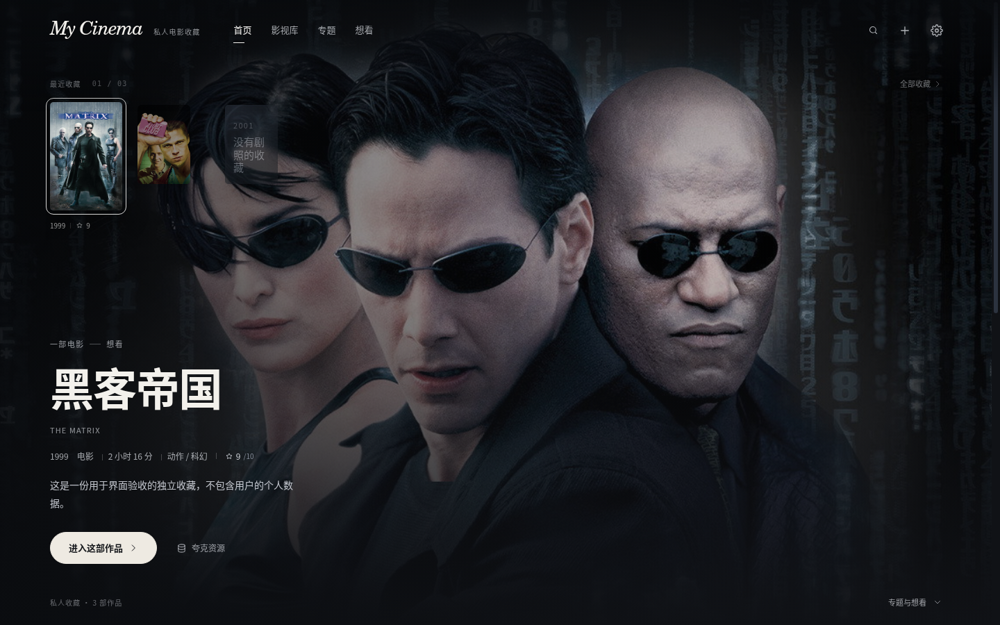

# My Cinema

一座属于自己的私人影视收藏馆。以 PS5 式沉浸浏览和电影杂志排版，整理电影、剧集与观影记忆。



[更多界面预览](docs/GALLERY.md)

## 能做什么

- 横向海报浏览，背景与焦点联动。
- 收藏、评分、观看状态、短评、系列分类与自定义专题。
- TMDB 搜索导入，海报和背景图本地缓存。
- 夸克资源记录、目录自动匹配与画质编码识别。
- 影视库一键刷新，海报墙与影视宇宙文件夹视图。
- 自动检查更新、可配置镜像与手选海报/背景。
- SQLite 本地保存，支持备份、恢复与 JSON 导出。

面向 Windows 10 / 11 x64 个人使用，不提供播放或下载功能。夸克真实账号接入、TMDB 在线完整链路及 Windows 桌面验收状态见[验证说明](docs/VERIFICATION.md)。

## 开始使用

[下载 Windows 安装包与免安装版](https://github.com/StQuasimodo/Media-Library/releases/latest)。安装与首次配置见[使用指南](docs/USAGE.md)。

稳定版为[1.2.0](https://github.com/StQuasimodo/Media-Library/releases/tag/v1.2.0)。[Windows1.3.0-beta.4](https://github.com/StQuasimodo/Media-Library/releases/tag/v1.3.0-beta.4)支持应用内更新、系列文件夹、通用剧集/衍生电影关联、分季横图分配、重新登录保留夸克目录和手选图库；首次需手动安装，之后可在应用检查更新。

[Android TV0.3.0-alpha.4开发预览](https://github.com/StQuasimodo/Media-Library/releases/tag/tv-v0.3.0-alpha.4)：优化遥控器、减少文字输入，内置镜像、通用衍生关联与分季横图分配；保留独立收藏、本机夸克WebDAV及内置播放，minSdk21/ARMv7/x86。可覆盖alpha.5，**不能覆盖更换签名前的旧安装**。[安装说明](docs/ANDROID-TV.md) · [两端验证与实机限制](docs/SERIES-RELATIONSHIPS.md#本轮交付2026-11-11)。

从源码开发需要 Node.js 22+ 和 pnpm 11：

```bash
pnpm install
pnpm dev
```

构建、测试和 Windows 打包见[开发指南](docs/DEVELOPMENT.md)。

## 文档

- [使用指南](docs/USAGE.md)：安装、TMDB 配置、数据备份与快捷键。
- [夸克网盘接入](docs/QUARK-WEB-CHECK.md)：账号登录、目录读取与验证边界。
- [视觉与交互](docs/DESIGN.md)：布局、字体、动效与可访问性。
- [架构说明](docs/ARCHITECTURE.md)：Electron、数据层与安全模型。
- [验证说明](docs/VERIFICATION.md) · [故障排查](docs/TROUBLESHOOTING.md) · [修复记录](docs/REPAIRS-2026-10-24.md)。
- [全部文档](docs/README.md)。
- [自动选图调研](docs/OPEN-SOURCE-ARTWORK-COLLECTIONS-2026-11-11.md) · [剧集与衍生电影关联算法](docs/SERIES-RELATIONSHIPS.md)。

个人非商业项目。影视资料与图片来自 TMDB；本产品未获得 TMDB 的认可或认证。
