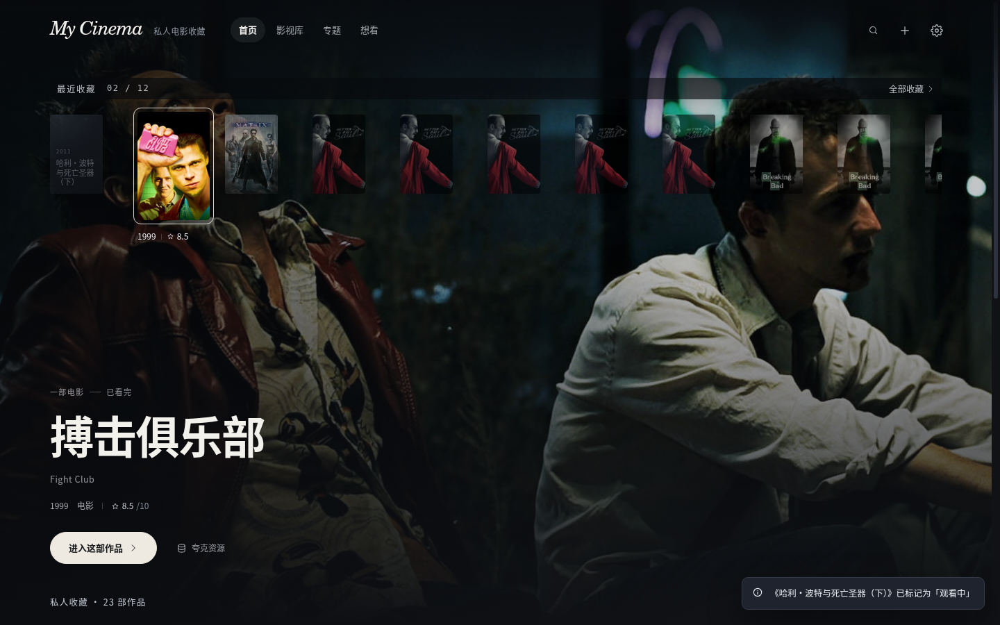

# My Cinema

一座属于自己的私人影视收藏馆。以PS5式沉浸浏览和电影杂志排版，收藏电影、剧集与每一次观影的记忆。

[Windows预览版](https://github.com/StQuasimodo/Media-Library/releases/tag/v1.3.0-beta.7) · [Android TV预览版](https://github.com/StQuasimodo/Media-Library/releases/tag/tv-v0.3.0-alpha.12) · [界面预览](docs/GALLERY.md) · [使用指南](docs/USAGE.md)

## 让收藏值得重看

- 沿着海报轨道选片，背景、标题和内容随焦点联动。
- 用海报墙陈列完整收藏，用系列文件夹整理关联剧集与衍生电影。
- 记录评分、观看状态、收藏理由与短评，编排自己的专题。
- 从TMDB搜索导入资料，缓存海报和背景；关联夸克目录，识别片名、季集与资源规格。
- 从电脑导出收藏与夸克整理结果，在电视合并导入，复用已知文件的匹配与忽略。
- 本地保存收藏，支持备份与恢复；双端均提供应用内更新和镜像回退。

## 从书桌到客厅

**Windows** 面向Windows 10 / 11 x64，专注沉浸浏览与收藏整理，提供安装版和免安装版。

**Android TV** 独立管理收藏，支持遥控浏览、夸克与WebDAV媒体源及内置播放。兼容Android 5.0及以上、ARMv7／x86；目前仍为开发预览，设备解码能力决定播放上限。安装、升级与兼容说明见[电视端指南](docs/ANDROID-TV.md)。

## 了解更多

[电脑到电视迁移](docs/DESKTOP-TV-TRANSFER.md) · [安装与配置](docs/USAGE.md) · [夸克自动匹配](docs/QUARK-MATCHING.md) · [视觉设计](docs/DESIGN.md) · [开发指南](docs/DEVELOPMENT.md) · [全部文档](docs/README.md)

个人非商业项目。影视资料与图片来自TMDB；本产品未获得TMDB的认可或认证。
