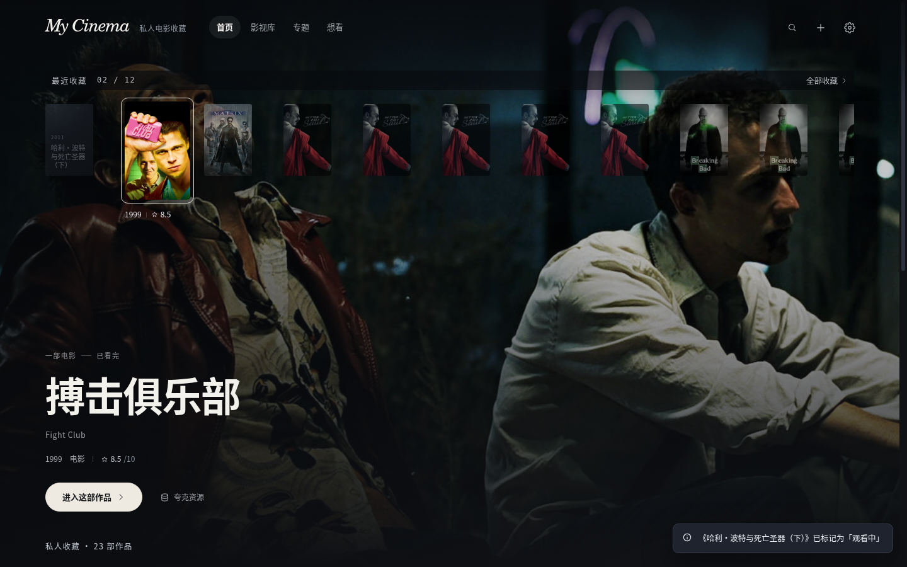
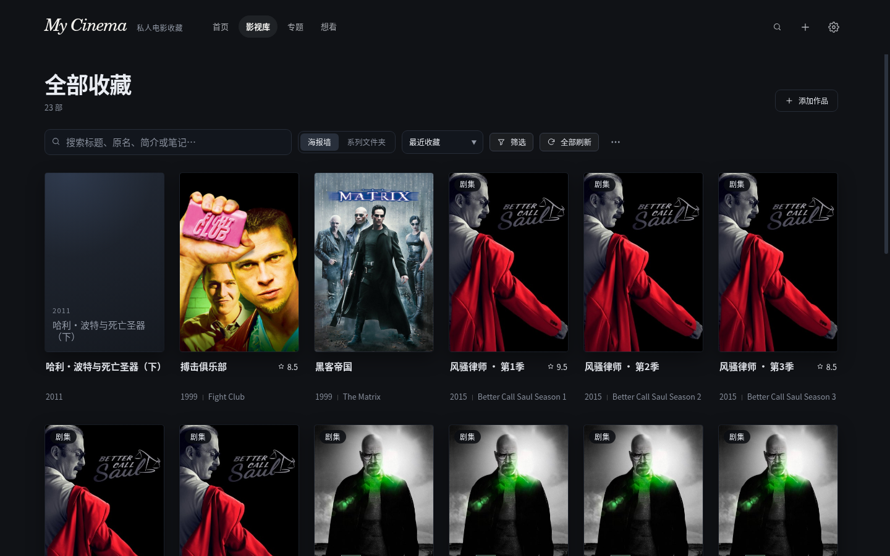
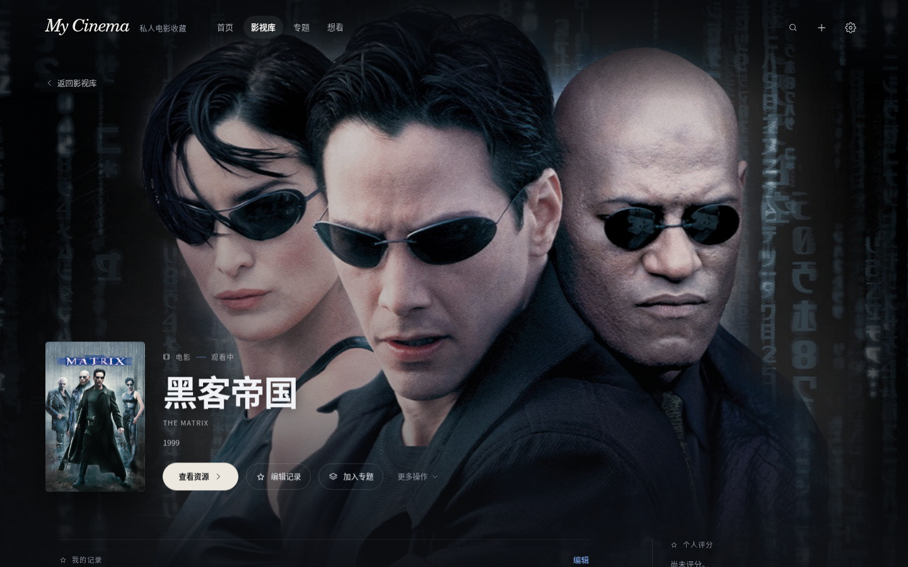
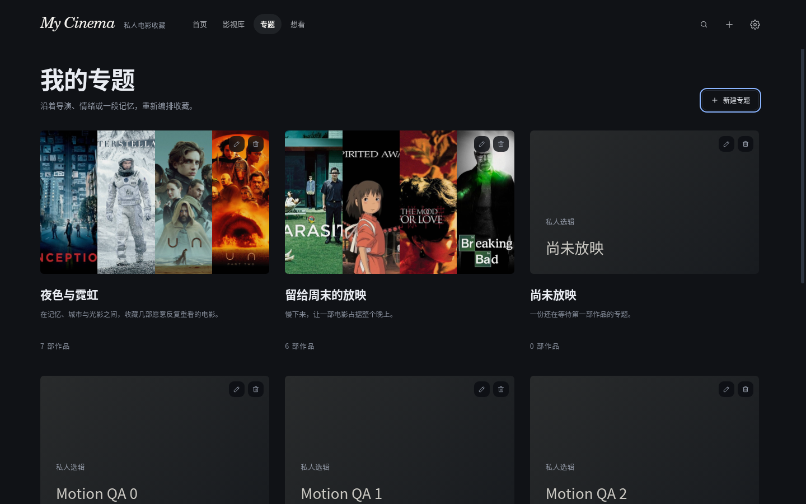
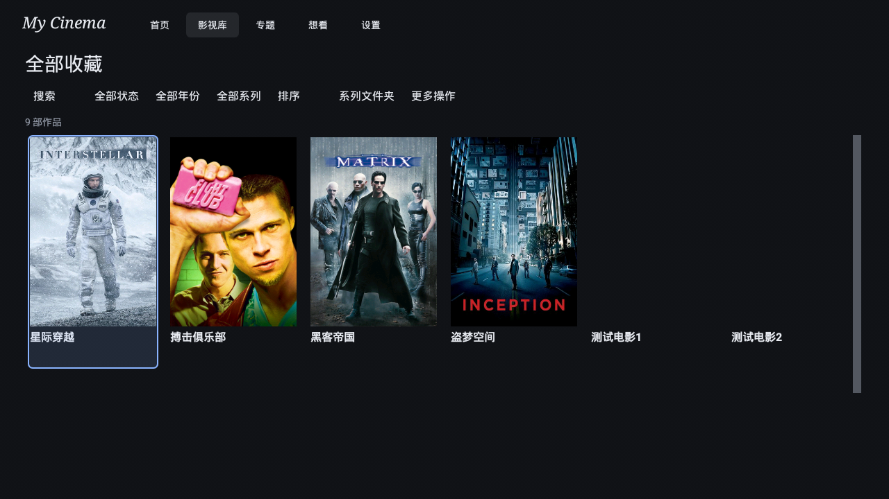
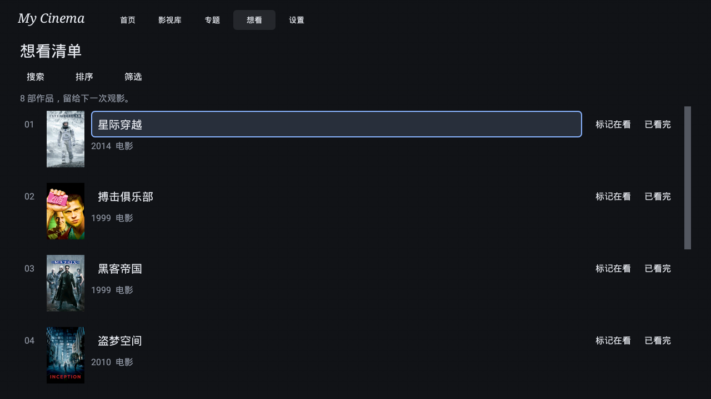
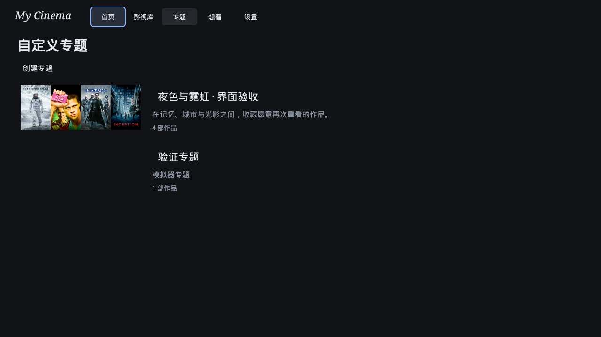

# 界面预览

[返回My Cinema](../README.md) · [Windows下载](https://github.com/StQuasimodo/Media-Library/releases/tag/v1.3.0-beta.6) · [TV下载](https://github.com/StQuasimodo/Media-Library/releases/tag/tv-v0.3.0-alpha.11)

## 电影成为浏览的中心

横向海报轨道与当前作品联动，保留大幅背景、克制排版和花体品牌。

## 陈列与整理，各得其所

影视库把更多空间交给海报；搜索、排序与视图切换触手可及，筛选按需展开。详情保留大幅画面，专题用封面呈现个人选片。

| 影视库 | 电影详情 |
|---|---|
|  |  |

## 在电视上，用遥控器浏览

舒适海报密度、清晰的焦点与编号想看队列，为客厅距离安排信息。

| 海报墙 | 想看队列 |
|---|---|
|  |  |

截图使用独立样本收藏。桌面图来自实际构建的Chromium渲染，TV图来自API22原生模拟器；不代表个人账号数据或电视实机效果。[验证说明](FRONTEND-OPTIMIZATION-2026-11-15.md) · [历史截图](GALLERY-HISTORY.md)。
