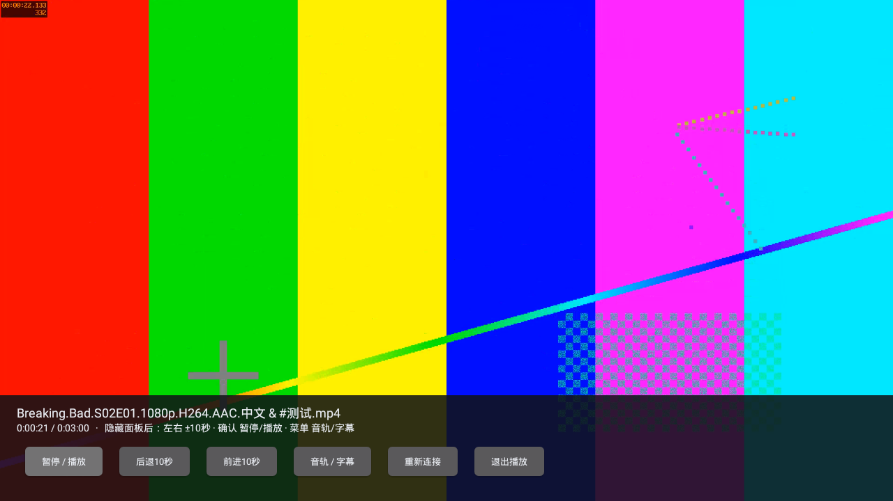
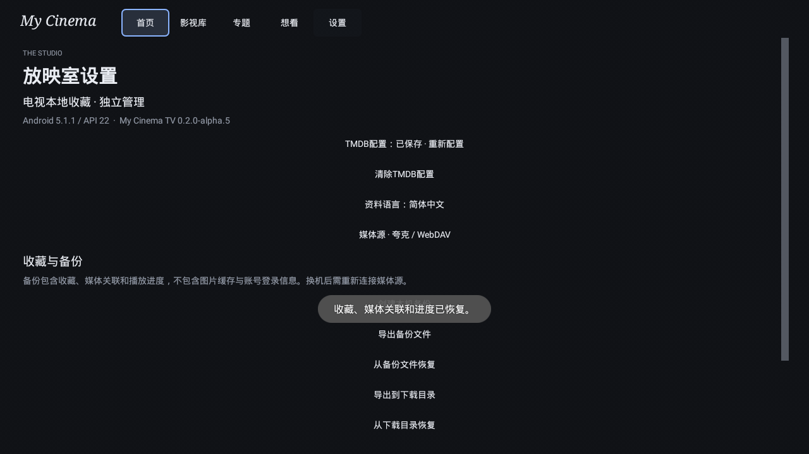

# TV 0.2.0-alpha.5 固定签名发布验证

`0.2.0-alpha.5 / code8` 的实际APK已通过[完整API22流程](https://github.com/StQuasimodo/Media-Library/actions/runs/42844482999)，并[发布为GitHub开发预览](https://github.com/StQuasimodo/Media-Library/releases/tag/tv-v0.2.0-alpha.5)。构建源码为 `3d0d68cdbd5febb1648a111c5c753a56ed4dbdd7`，报告/发布说明提交不是APK构建源码。[发布流程42846487012](https://github.com/StQuasimodo/Media-Library/actions/runs/42846487012)使用原始已验证字节，未重新打包。

## 产物身份

- APK：`My-Cinema-TV-0.2.0-alpha.5-debug.apk`，48,749,074字节。
- SHA-256：`1c03fd9052ec49124dc679302bde543269a1f969288d58fb7e4286cdf43c5fda`。
- 实际证书：`be6ca6625b1cc4457d0e016fe8c7b300cd0285cf2cee0ae9ac9e8ed79a8249ad`，与当前固定指纹相同；RSA3072，v1/v2签名校验通过。
- minSdk21、target35、DEX035，包含ARMv7/x86的LibVLC3.7.7与运行库；Lint为0错误/17警告。
- GitHub Secret恢复在独立准备任务和构建任务中均通过；实际构建包的 `pinnedSignerVerified=true`。本地重新核对原始APK与BUILD/SHA清单，收藏回归的目标包哈希与候选一致。

[BUILD身份](../artifacts/tv-alpha5-2026-11-10/BUILD.json) · [包哈希清单](../artifacts/tv-alpha5-2026-11-10/APK-SHA256SUMS.txt) · [证书验证](../artifacts/tv-alpha5-2026-11-10/signature.txt) · [汇总](../artifacts/tv-alpha5-2026-11-10/summary.json)。仓库只保存公开元数据、合成数据结果及截图，不保存签名密钥或测试私有证书。

Release包含APK、BUILD.json、SHA256SUMS.txt共3项；GitHub资产digest逐项与原始构建文件相同，Tag固定在上述构建源码。发布脚本源码为 `7d6ed76a095230055424c2d4ff61c9169ad0a970`。本地原始产物核对与服务端digest均通过；Windows Latest仍为v1.2.0。[公开发布回执](../artifacts/tv-alpha5-2026-11-10/published-release.json)。

## 实际运行结果

使用真正Android5.1/API22 x86模拟器，1280×720；收藏回归应用Java堆限制为96MiB。媒体为180秒1920×1080、15fps H.264/AAC合成素材，双音轨与单条mov_text字幕；夸克/TMDB成功链路使用受控HTTPS服务，公共TMDB另验真实无效Key的401。

| 范围 | 本次结果 |
|---|---|
| 安装与界面 | 实际新固定签名APK安装、原生Activity/SQLite/Keystore、首页焦点联动及遥控器通过；首次安装无演示收藏 |
| 播放 | LibVLC实际解码视频/音频并显示新帧；双音轨选择、单条内嵌字幕、定位、遥控暂停/恢复及新Activity续播通过 |
| WebDAV | 本机真实只读DAV与外部来源；鉴权、目录范围、精确Range/HEAD/尾部、4MiB有界分段、并发过期合并刷新、有限断流续接和取消通过 |
| 生命周期 | 原始夸克/外部DAV/本机DAV阻塞取消、扫描销毁、旧回调丢弃、其他播放会话不受影响、暂停/快速重连、播放结束后重播通过；倍速重连保留通过 |
| 连续播放 | 观测90,024ms，媒体时钟推进90,001ms，新增显示1,354帧；PSS起止165,806/159,655KiB。不是峰值内存或真实设备流畅度承诺 |
| 命名与匹配 | 29组命名样本、9项匹配约束、5项SQLite保留检查通过，包含明确S00与手工关联保持 |
| 备份 | 16项检查通过：系统文件服务跨进程I/O、下载目录、确认/取消、v1兼容、人工关联/进度、账号保持、两库失败回滚及AtomicFile中断恢复 |
| 收藏回归 | 真实SQLite收藏/专题/分季/系列/搜索/筛选及压力数据、杀进程重开、实际模拟器内核重启通过；测试目标APK哈希与候选一致 |

[通用播放](../artifacts/tv-alpha5-2026-11-10/playback-report.json) · [网关与90秒播放](../artifacts/tv-alpha5-2026-11-10/quark-dav-report.json) · [命名](../artifacts/tv-alpha5-2026-11-10/resource-names-report.json) · [备份](../artifacts/tv-alpha5-2026-11-10/backup-report.json) · [收藏/进程/重启](../artifacts/tv-alpha5-2026-11-10/collection-summary.json)。

## 边界与安装

这次验证的是**新固定签名包的全新安装与运行**。它不能覆盖旧证书的alpha.2/alpha.3；旧安装有数据时应先导出，确认有效后再迁移，并重新配置登录。此前code7→8升级属于独立测试身份实验；本轮没有把它冒充当前固定签名的生产身份升级。下一次同身份版本递增仍应验收覆盖安装和凭据/进度保留。

ARMv7已打包但未实际运行；长虹实机、真实TMDB/夸克账号及旧WebView扫码仍未验收。模拟器使用 `-noaudio`，没有验收可听音频、音画同步、环绕/直通；4K原盘、高码率HEVC/HDR与持续整片播放没有本轮实测。生产路径仍为LibVLC；mpv/双字幕不在本次APK中。备份的真实跨进程I/O已通过，但系统文件选择器完整UI、物理断电、大库恢复仍未验收。Windows本轮未重跑，版本仍为1.2.0。

## 流程修复记录

[首轮流程42843363050](https://github.com/StQuasimodo/Media-Library/actions/runs/42843363050)已完成签名、构建和包校验，随后依赖准备阶段约4分钟没有输出，尚未进入模拟器；主动取消，未计为运行成功。改为优先复用runner已有ffmpeg，并给APT和样片生成设置超时，后续完整流程通过。没有因此更换密钥或跳过播放器/收藏验证。

发布脚本只摘取当前版本说明，避免把历史开发状态当成本版状态；继续校验成功原始流程、精确源码、APK/BUILD哈希、固定证书、API21/ABI与完整播放门禁，不重新打包、不替换既有资产或移动历史Tag。
