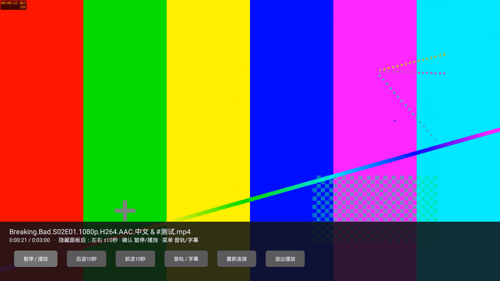

# 播放器与WebDAV架构优化验证（2026-10-29）

`0.2.0-alpha.4` / code7已通过[完整API22流程](https://github.com/StQuasimodo/Media-Library/actions/runs/40814162433)。播放器、WebDAV协议、驱动取流和网络取消职责分开；[架构与固定源码参考](TV-PLAYBACK-ARCHITECTURE.md)说明具体取舍，真实夸克速度和长虹实机仍未验收。

## 本轮结果

- `PlaybackController`管理状态、解码器、恢复定位及生命周期；Activity负责原生界面与遥控器。连接解析完成且仍为最新会话后才创建解码器，被取消的尝试不提前分配原生播放器。
- `PlaybackRelay`管理本机HTTP/DAV、目录范围和临时鉴权；`MediaTransfer`通过Provider获取短期地址，管理每文件刷新、精确区间及断流恢复。参考TV Media/OpenList思路，未嵌入它们的完整运行时或复制AGPL实现。
- 夸克以最多4MiB闭合Range顺序读取、64KiB边读边发；不增加大型预取缓存。HEAD通过1字节GET探测，支持尾部区间，首段/续接/后续段都核对真实长度与区间。
- `NetworkScope`取消实际OkHttp调用及响应体，覆盖目录、下载地址API和视频读取。每次内置播放使用独立的文件级本机鉴权，退出/重连时撤销并取消对应请求，普通目录连接保留。
- 修正暂停定位尚未完成便暂停的问题，准备期间静音；补齐缓冲完成回到PLAYING的转换，并防止终止后的缓冲回调或计时器覆盖结束归零状态。

## 实际测试

官方模拟器33.1.24.0/build11237101，Android5.1/API22、x86、1280×720、约1GiB RAM。收藏回归实际Java堆上限96MiB。视频为180秒1920×1080、15fps H.264/AAC合成样片，含双音轨及内嵌字幕；夸克上游是受控HTTPS服务，本机WebDAV和LibVLC均为应用实际实现。

| 检查 | 实测 |
|---|---|
| 跨段完整性 | 请求超过5MiB并跨越4MiB边界，拼接后与基准逐字节相同；上游拒绝开放区间时仍成功，最大请求区间4,194,304字节 |
| HEAD与尾部 | 上游不接受HEAD时，本机HEAD返回正确全长且无响应体；`bytes=-64`返回真实末尾64字节 |
| 错误区间 | 首个响应Content-Range不符时，在输出视频前返回502；续接被忽略时拒绝拼入错误内容 |
| 并发过期 | 两个旧地址请求实际同时收到403，只重取一次下载地址，两个响应均正确 |
| 取消取流API | 上游下载地址API被人为阻塞10秒；停止真实网关后，1ms时观测到客户端结束且工作线程空闲，未等待超时。该值仅属于本次模拟器测量 |
| 断流恢复 | 截断视频且使旧地址过期后，逐字节恢复与原生播放均通过；持续截断在两次续接后停止 |
| 播放与状态 | 实际显示新帧、拖动、遥控暂停/继续；暂停后重连保留位置与暂停，连续三次重连仅保留最新有效连接，画面和PLAYING状态同时通过 |
| 结束及退出 | 播完归零后计时器不覆盖；重新连接从片头播放。重连和退出撤销旧会话鉴权，旧凭据401；退出后旧连接回调不能重建解码器 |
| 连续播放 | 观测90,298ms，媒体时钟推进90,246ms，新增显示1,253帧；每5秒检查时钟推进。没有据此宣称无掉帧或达到物理电视的性能目标 |
| 内存取样 | 这段观测的进程PSS起点164,933KiB、终点158,818KiB；不是峰值、内存泄漏结论或与旧版的受控性能对比 |
| 原功能 | 外部WebDAV鉴权、双音轨/内嵌字幕选择、凭据隔离、文件名关联、收藏/专题/备份恢复、504条/500图片键、进程重开与实际内核重启通过 |

[聚合结果](../artifacts/tv-playback-architecture-2026-10-29/summary.json) · [原始转换/架构/播放报告](../artifacts/tv-playback-architecture-2026-10-29/quark-dav-report.json) · [通用播放报告](../artifacts/tv-playback-architecture-2026-10-29/playback-report.json) · [收藏回归](../artifacts/tv-playback-architecture-2026-10-29/collection-summary.json) · [源码文件哈希核对](../artifacts/tv-playback-architecture-2026-10-29/sources.json)。

## 可安装产物

从[成功流程](https://github.com/StQuasimodo/Media-Library/actions/runs/40814162433)底部下载Artifact **`my-cinema-tv-0.2.0-alpha.4`**，包含`My-Cinema-TV-0.2.0-alpha.4-debug.apk`、BUILD.json、SHA256SUMS.txt。本轮未创建GitHub Release。

- 实际APK构建源码：`6e4b7d8bca66295445d43aaa7a6668c0dc617260`，后续报告提交不是构建源码。
- 大小48,734,454字节；SHA-256：`78da12fd32b681462ae1966788ca8d61bb734fd6f8f75ac60c8350e43fb666eb`。
- 下载后两个校验项通过，完整收藏回归所测APK与下载文件哈希相同；[构建身份](../artifacts/tv-playback-architecture-2026-10-29/BUILD.json)。
- minSdk21、compile36、target35，DEX035、v1签名及ARMv7/x86检查通过；开发签名仍为`0e343d7d8d91f931b0350b7c01f87115f2fc7daf6402c0baee8276ced4a9bd44`。
- Gradle、Lint、独立测试APK及完整流程成功，Lint为0错误、17警告。Windows保持1.2.0，电视收藏库及媒体库schema仍为1，凭据路径/别名、应用ID和数据目录不变。

## 失败与取消记录

[七次运行记录](../artifacts/tv-playback-architecture-2026-10-29/attempts.json)保留完整来源：两轮主动取消以纳入复查修正；一轮在暂停定位恢复失败；一轮快速重连未满足状态/画面联合断言；一轮在Lint缩进错误停止；下一轮诊断明确显示画面和时钟推进、状态仍为BUFFERING。最终补齐缓冲完成状态转换后，全部通过。

相关失败原始报告：[暂停恢复](../artifacts/tv-playback-architecture-2026-10-29/attempt2-quark-dav-report.json)、[快速重连](../artifacts/tv-playback-architecture-2026-10-29/attempt4-quark-dav-report.json)、[Lint](../artifacts/tv-playback-architecture-2026-10-29/attempt5-lint-results-debug.xml)、[有画面但状态错误](../artifacts/tv-playback-architecture-2026-10-29/attempt6-quark-dav-report.json)。失败不能算通过，快速重连断言失败也不能直接认定解码器没有显示视频。被取消/失败运行均未生成可交付安装包Artifact。

## 未验收范围

真实夸克账号、旧WebView扫码、账号权限/会员限速/CDN、真实提速、长虹ARM硬解/声音/遥控器及整片数小时播放，仍未验证。90秒合成H.264样片不证明4K/HEVC/HDR、复杂字幕、音频直通或512MiB设备能力。没有真实凭据被写入源码、日志或Git。

网关仍只监听电视本机并以前台生命周期运行；自动Home键后台停止未单独作为实测项。没有新增外部播放器后台服务、局域网共享、离线下载、本地U盘播放或自动连播。缺乏版本标记时，稳定文件ID与长度仍不能证明同长度覆盖写未发生。后续应先进行真实账号与整片播放测试，再按结果调整分段、超时或缓存。
