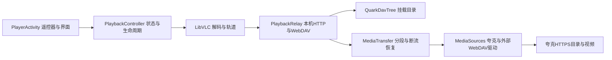

# 电视播放器与WebDAV架构

2026-10-29，`0.2.0-alpha.4` / code7。在现有Java/API21工程内调整职责，保留LibVLC3.7.7、OkHttp3.12、SQLite及夸克本机转换；不接入需要更高系统版本的完整播放器或网关应用。

## 职责与生命周期

- `PlayerActivity`只构建原生界面、处理遥控器/轨道菜单和保存进度回调。它不持有网络线程、临时URL刷新逻辑或全局VLC登录回调。
- `PlaybackController`拥有解码器、Surface连接、连接任务及状态快照。状态包括STOPPED、CONNECTING、BUFFERING、PLAYING、PAUSED、ENDED和ERROR；旧异步任务及原生事件按会话代数和解码器身份过滤。连接解析后只为最新尝试创建解码器；重连保留位置和暂停意图，恢复定位前的临时零时钟不会覆盖已存位置，暂停恢复准备阶段静音。缓冲完成显式返回PLAYING，终止状态忽略迟到缓冲事件。VLC静态登录回调按所有者释放，旧控制器不清除新所有者。
- `PlaybackRelay`保留有界工作线程、本机监听、鉴权、HTTP解析与DAV方法。`QuarkDavTree`继续校验选中目录范围；视频策略独立放在`MediaTransfer`，目录与协议不再直接管理短期URL及重试。
- `MediaTransfer`依赖小型Provider接口获取短期地址；八项LRU与每文件锁管理地址。同一旧地址并发401/403时比较被拒绝的Lease身份，只由首个请求刷新；在途解析项在缓存淘汰时保留。网络解析不持有全局缓存锁。错误按资源记录，正常拖动关闭客户端不当作源故障。
- `NetworkScope`拥有OkHttp Call及响应体读取。连接尝试、每个HTTP请求、每个播放会话和网关停止都有清理路径；取消不仅作用于Future，也能中断目录/下载地址API及视频读取。

本机WebDAV普通目录连接仍使用原临时账号。内置播放器另取仅供当前文件GET/HEAD的独立临时鉴权；退出/重连撤销该鉴权并取消该会话的请求。其他播放会话、目录连接和挂载选择不因此失效。鉴权不写入URL、Intent、SQLite或日志；夸克Cookie不交给LibVLC。服务仍限127.0.0.1与应用前台，无NAS依赖。

## 有界取流

夸克默认以最多4MiB的闭合Range顺序取流，使用64KiB拷贝缓冲。段是网络区间，不是必须先分配4MiB的内存缓存；没有并行预读窗口、整片下载或电视转码。播放器请求全片或开放尾部时，仍获得正确的完整长度，后续段在同一个本机响应内继续写入，不把一段冒充整片长度。

HEAD通过`GET bytes=0-0`的实际响应头探测，获取可信总长度后立即关闭上游；外部WebDAV保留HEAD并在405/501时回退探测。尾部Range由可信总长度解析。首段、后续段和断流续接均核对实际Content-Range、长度、编码和可用的版本标记；不伪造206或猜测总长度。支持Range的响应缺少Accept-Ranges时按已验证206声明bytes。

单个本机视频响应最多续接两次；每次取流请求遇夸克401/403最多更新一次地址。Cookie在每次上游同源请求时读取当前保存值，跨源重定向不转发鉴权，HTTPS不降级。上游不支持精确Range时，不能承诺任意定位或安全拼段；未知总长度、同长度覆盖写及缺乏版本标记仍有边界，实际服务变化需要账号验收。

## 本轮参考的固定源码

| 来源 | 读取的代码与借鉴点 | 本项目采用方式 |
|---|---|---|
| [TV Media](https://github.com/Shield1st/tvmedia-public/tree/13d43eda1624bd0b95ed8728c20b2b715c74e669) | `LocalProxyServer.kt`的有界Range、正确全长、HEAD探测、尾部区间及正常断开；`ui/player/PlayerActivity.kt`的生命周期清理、播放器状态与遥控器分工 | 自行实现顺序4MiB分段及明确所有权，不搬运其多窗口预读、无限线程池、Media3/API24工程或凭据降级策略 |
| [OpenList Quark/UC驱动](https://github.com/OpenListTeam/OpenList/tree/74320ca6dbde96e546b2e5183bae228a88139bd0/drivers/quark_uc) | `driver.go`的List/Link边界；`util.go`中临时下载地址、必需请求头与Cookie更新 | 驱动只返回短期Lease，取流层负责刷新和传输；沿用API21加密保存，不引入Go服务或授权中继 |
| [LibVLC3.7.7源包](https://repo.maven.apache.org/maven2/org/videolan/android/libvlc-all/3.7.7/) | MediaPlayer事件、Dialog登录回调及释放契约 | 保留原生API和AAR，按会话过滤回调，并对静态Dialog回调执行所有者检查 |

这是对协议和分工的研究及本项目独立实现，没有复制TV Media/OpenList的AGPL实现到应用，也未嵌入它们的运行时。既有LibVLC/OkHttp许可说明继续适用。

开源项目关于夸克请求形式与速率的测试只属于其环境。本项目当前不能声称达到相同带宽或绕过账号限速。实际构建、模拟器与真实账号边界应以本轮验证报告为准。

[完整构建、API22实测与开发APK](TV-PLAYBACK-ARCHITECTURE-VALIDATION-2026-10-29.md)。
