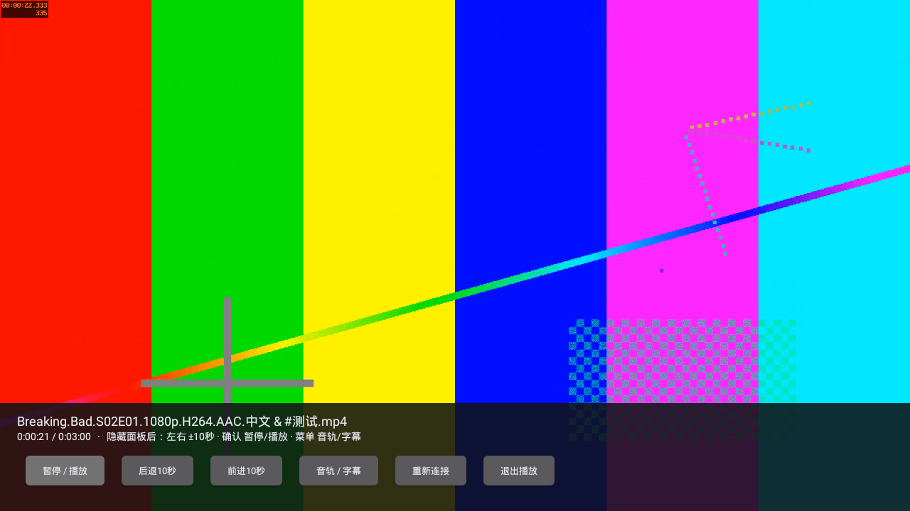

# 电视播放链路与断流恢复验证（2026-10-28）

`0.2.0-alpha.3` / code6将夸克播放从两层本机转发改为一层，并补齐有限断流恢复、缓冲提示和保留进度重新连接。保留上一版夸克选目录、只读WebDAV、收藏关联与LibVLC架构，无需NAS或电脑。

## 改动

播放现在走：**夸克HTTPS视频 → 电视本机WebDAV → LibVLC**。原生播放器直接连接已生成的本机服务，目录/端点核对放到后台线程，离开页面取消连接并丢弃迟到回调。外部WebDAV仍沿用原转发方式。

本机Basic鉴权通过LibVLC登录回调处理，临时密码不写入播放网址、Intent或数据库，且不要求LibVLC持久化。播放器接触不到夸克Cookie，网关不向播放器返回上游重定向；Cookie及Referer继续由网关处理。

对已知长度的夸克响应，中途读取失败后从已成功写出的精确字节位置续接，**单个响应最多续接两次**。每次取流请求（包括续接）遇401/403最多重取一次地址。核对206、区间起止、总长度，以及原响应可用的强ETag或Last-Modified；不符合时关闭响应。下游关闭不会触发这种续接，已输出视频后不再追加HTTP错误页。没有全片内存缓存、磁盘缓存或电视转码。

控制面板显示缓冲状态，并增加「重新连接」：保存进度、释放旧解码器及连接、重新解析媒体源后续播。缓存仍为1500ms，没有为此扩大内存缓冲。

## 构建与安装包

[完整成功流程](https://github.com/StQuasimodo/Media-Library/actions/runs/40670992547)，实际构建源码为`46a9bee450f2c6263267b2dd01dda4e821713a51`；后续文档提交不是APK构建源码。

- 下载该流程Artifact **`my-cinema-tv-0.2.0-alpha.3`**，其中有`My-Cinema-TV-0.2.0-alpha.3-debug.apk`、BUILD.json及SHA256SUMS.txt。本轮未创建GitHub Release。
- APK：48,723,912字节；SHA-256：`c088233ba4ebf07f9a30a50a3bfe8c4ddbfbfe92ec7ce771c4a43cd79fa30824`。下载后二项校验均通过，收藏回归所测APK哈希与下载文件一致。
- minSdk21、compile36、target35、DEX035、ARMv7/x86及v1签名检查通过；开发签名仍为`0e343d7d8d91f931b0350b7c01f87115f2fc7daf6402c0baee8276ced4a9bd44`。
- Gradle、独立测试APK构建、Lint及整个API22流程成功；Lint为0错误、17警告。Windows仍为1.2.0，收藏/媒体库schema、应用ID和TMDB凭据路径不变。

## 实际结果

环境为官方模拟器33.1.24.0/build11237101、Android5.1/API22、x86、1280×720、约1GiB RAM；收藏回归实际Java堆上限96MiB。视频为FFmpeg生成的180秒1920×1080、15fps H.264/AAC样片，含双音轨和内嵌字幕。夸克HTTPS上游使用一次性受控服务，WebDAV是应用自身真实HTTP服务。

| 检查 | 结果 |
|---|---|
| 单层播放 | LibVLC实际媒体地址属于本机挂载服务，播放器未创建第二个转发服务；Basic鉴权后真实显示新帧 |
| 断流与过期 | 上游先发送部分视频后断开，旧地址随后403；获取新地址并从精确字节继续，响应体与完整基准逐字节相同 |
| 故障边界 | 持续断流在初次读取加两次续接后停止；续接请求被服务端忽略、返回完整200时拒绝拼接 |
| 原生断流恢复 | LibVLC自身播放时实际注入断流及地址过期，恢复后显示视频；不是只用HTTP客户端代替播放器 |
| 定位与连续播放 | 定位后时钟22.318秒并显示新帧；随后连续观测90,024ms，媒体时钟推进89,999ms，新增显示1,350帧；每5秒检查进度推进 |
| 播放进程PSS | 连续观测起点157,771KiB、终点160,689KiB；仅是两个取样点，不能当峰值或长期无泄漏证明 |
| 重连与续播 | 网关重建后换地址/密码仍可续播；原生「重新连接」按钮重建解码器并保留位置 |
| 兼容回归 | 外部WebDAV鉴权、双音轨/字幕、遥控暂停、收藏业务、504条/500图片键、进程重开及实际内核重启通过 |

[聚合结果](../artifacts/tv-playback-stability-2026-10-28/summary.json) · [原始夸克转换/播放报告](../artifacts/tv-playback-stability-2026-10-28/quark-dav-report.json) · [通用播放报告](../artifacts/tv-playback-stability-2026-10-28/playback-report.json) · [收藏回归](../artifacts/tv-playback-stability-2026-10-28/collection-summary.json) · [构建身份](../artifacts/tv-playback-stability-2026-10-28/BUILD.json)。

截图中的色条、时间码和文件名为合成测试素材，不是用户网盘影片，也不代表4K/HEVC/HDR或复杂字幕能力。

## 失败记录及验收范围

[首轮原始报告](../artifacts/tv-playback-stability-2026-10-28/attempt1-quark-dav-report.json)和[两次尝试](../artifacts/tv-playback-stability-2026-10-28/attempts.json)保留：第一轮协议续接测试通过，但LibVLC3.7.7未采用media http-user/http-pwd参数，本机直接播放收到401，整轮失败。改用正式登录回调后重跑，完整流程成功；失败构建未交付为可安装预览。

真实夸克账号、API22旧WebView扫码、账号权限/会员限速/CDN，以及长虹ARM硬解、音频输出和遥控器仍未验收。**90秒受控播放不能代替真实电影整片或数小时播放验证**，也不能证明512MiB设备或4K资源流畅。云环境没有配置真实夸克凭据，本轮没有实际用户账号取流成功结论。

续接依赖服务端支持精确Range及可验证长度；没有版本标记时只能依赖稳定文件ID与长度，不能证明同长度覆盖写未发生。自动Home键后台停止仍未单列为实测；网关停止/重建已测。服务继续仅限本机前台使用，未加入离线下载、U盘文件播放、自动连播或外挂字幕。后续优先进行真实账号连接/过期/拖动和整片播放验收，再按实际瓶颈调整超时及缓冲。
