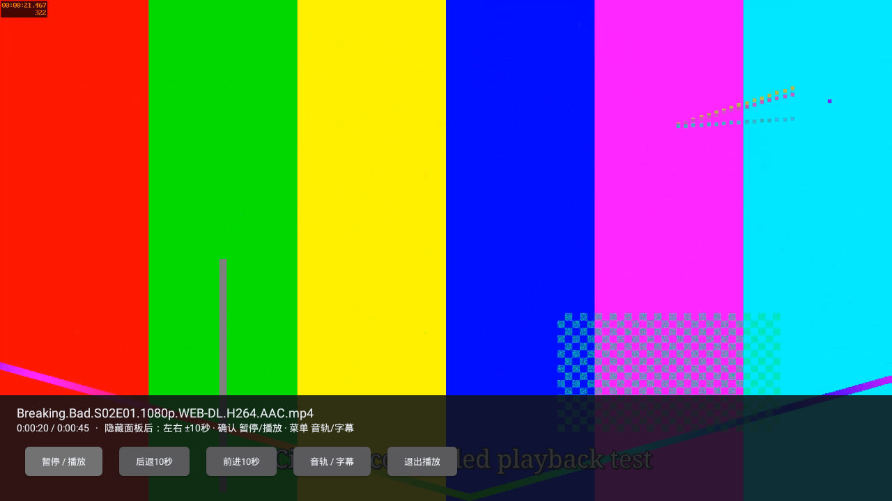
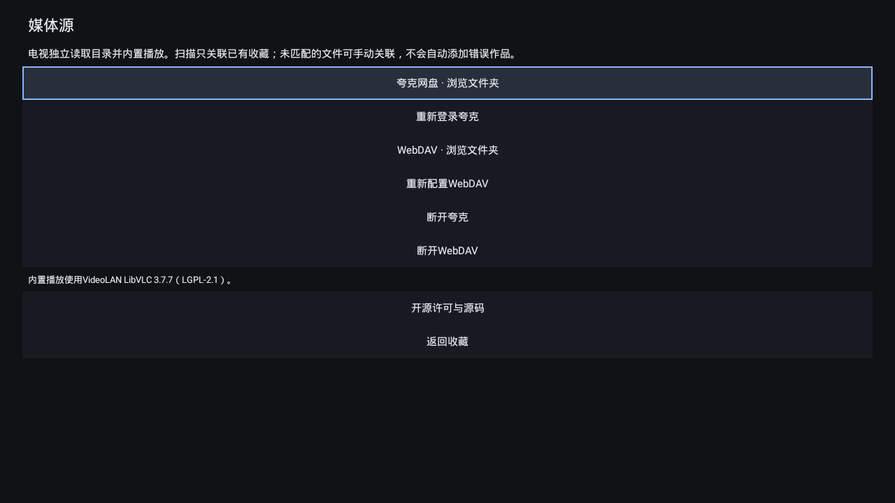

# 电视播放开发验证（2026-10-28）

电视端`0.2.0-alpha.1` / code4的首个可验证播放原型已完成并推送。当前提供Actions开发产物，未创建新版GitHub Release；真实账号接入与长虹实机仍须验收。[使用路径与功能范围](TV-PLAYBACK.md)。

## 最终受测产物

[完整构建与API22流程](https://github.com/StQuasimodo/Media-Library/actions/runs/40632642462)全部通过，构建源码`a60b04f3471486413939f32e5b9b1f9e65d7c813`。后续报告提交不冒充APK构建源码。

- `My-Cinema-TV-0.2.0-alpha.1-debug.apk`，48,708,509字节；运行页面的`my-cinema-tv-0.2.0-alpha.1` Artifact可下载。
- SHA-256：`8f9d7fa23d1e3f963b0df1e78433c3325ea0af310cd9937a8be79cf1ef19048d`。下载后按原校验文件验证APK与BUILD.json均通过；收藏回归目标APK哈希与此相同。
- minSdk21、target35、compile36；包含armeabi-v7a/x86的LibVLC3.7.7共享库，DEX035和v1签名检查通过。
- 开发签名指纹仍为`0e343d7d8d91f931b0350b7c01f87115f2fc7daf6402c0baee8276ced4a9bd44`。不是生产签名；alpha.1不能用该签名覆盖，沿用[此前限制](ANDROID-TV.md)。

[构建身份](../artifacts/tv-playback-2026-10-28/BUILD.json) · [签名](../artifacts/tv-playback-2026-10-28/apk-signature.txt) · [校验文件](../artifacts/tv-playback-2026-10-28/SHA256SUMS.txt) · [聚合结果](../artifacts/tv-playback-2026-10-28/summary.json)。APK二进制不提交到Git仓库。

## 已实际执行

| 检查 | 结果与边界 |
|---|---|
| Android构建与Lint | 通过；0错误、17警告。警告包括旧target、横屏、i18n及官方授权页启用JavaScript等，没有强行忽略minSdk错误 |
| WebDAV | 受控HTTPS PROPFIND，账号密码与匿名连接通过；匿名不发送空Basic鉴权。错误账号、越界href和相对目录处理通过；失败配置保留旧配置 |
| 资源匹配 | 季集、画质、编码/音轨/HDR解析，唯一季号关联，缺季号/多候选拒绝自动关联，手动取消关联后再次扫描仍保留取消状态 |
| 夸克协议 | 受控会话/目录/取流、独立加密、异常会话不回显原值、临时地址403后只重取一次、精确64字节Range206通过；未登录真实账号 |
| 内置解码 | 真实API22/x86模拟器运行LibVLC；受控HTTPS WebDAV样片1920×1080、15fps H.264、双AAC音轨与mov_text内嵌字幕，实际解码视频114帧、显示31帧、解码音频353计数时采样 |
| 定位和续播 | 定位到20秒后，等待播放时钟继续前进及新帧显示；记录21.319秒。暂停/继续、退出后SQLite重开，以及新播放Activity读取进度后继续前进通过 |
| 收藏回归 | 搜索、分季导入、缓存、个人记录、专题、资源、备份恢复、504条收藏和图片压力、杀进程重开与实际内核重启通过 |
| 公网边界 | 单独核对公网DNS，真实TMDB HTTPS收到故意无效Key的401；不等于真实Key搜索/导入成功 |
| Windows回归 | 本地Vitest15文件/170项通过，Windows业务源文件未改；未重新发布Windows版 |

[播放原始报告](../artifacts/tv-playback-2026-10-28/playback-report.json) · [收藏完整回归](../artifacts/tv-playback-2026-10-28/collection-full.json) · [重开](../artifacts/tv-playback-2026-10-28/collection-process.json) · [内核重启](../artifacts/tv-playback-2026-10-28/collection-reboot.json) · [公网报告](../artifacts/tv-playback-2026-10-28/public-network.json)。

模拟器RAM实测1,056,206,848字节，收藏回归Java堆实测96MiB。播放阶段PSS单点149,969KiB，含原生内存，不是峰值、帧率或流畅度基准；播放阶段没有单独验证64/96MiB应用堆，更没有验证512MiB整机RAM。此前收藏界面的低堆矩阵不能直接用于视频播放结论。

## 实际界面

以下是API22原生应用和真实LibVLC窗口，样片为FFmpeg生成的色条/时间码、双音轨与字幕，不是用户影片。文件名和连接状态使用受控数据，不证明真实夸克账号已连接。

## 未验收与下一关

真实夸克官方扫码、API22旧WebView页面兼容、真实目录/会员权限/限速和真实CDN取流尚未验证。当前自动扫描只关联已有收藏，不自动新增TMDB作品；不能将受控协议测试写成账号绑定成功。

未连接长虹55D2S，没有ARM硬解、声音输出、遥控器/中文输入、真实升级和真实电视重启测试。HEVC、4K/HDR、复杂ASS及音频直通不能由该H.264样片证明。外挂字幕、自动下一集、全片下载及配额磁盘缓存尚未开发。

原收藏库仍为schema1，TMDB凭据文件与Keystore别名保持原样；新增媒体源数据库和凭据独立保存。收藏JSON备份不包含新增媒体源关联/进度。跨版本实机保留状态和完整导出备份需在长期beta前补齐。

## 本轮失败与修复

[全部尝试记录](../artifacts/tv-playback-2026-10-28/attempts.json)保留失败、取消和通过的区别。先后解决compileSdk要求、CI缺FFmpeg、隔离网络校验、模拟器重启失联及只读系统分区。播放测试与重启回归拆开顺序，测试前清理旧报告，校验当前运行ID和夹具地址；公网检查恢复原路由并排除测试域名映射。系统CA与hosts修改仅限明确的一次性模拟器，应用不绕过TLS，用户电视不需要ADB或修改安全设置。

最终流程是完整通过，不把早期403、未到达的播放步骤或中断后留下的旧文件算成通过。真实账号和硬件的待验收项继续保留。
