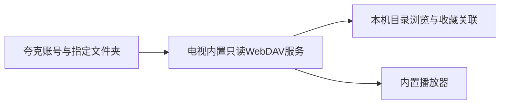
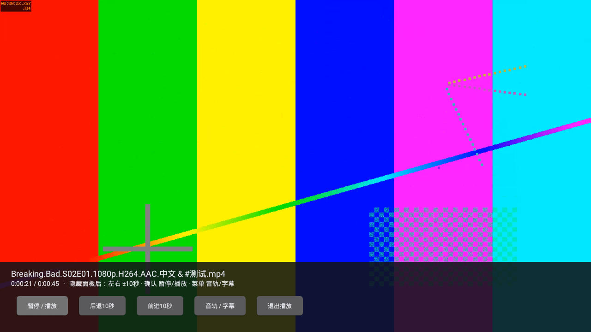

# 电视本机夸克转WebDAV（2026-10-28）

`0.2.0-alpha.2` / code5新增真正的电视本机只读WebDAV转换服务。视频源来自用户选定的夸克文件夹，不要求自行提供外部WebDAV服务、NAS或电脑。alpha.1实现的是客户端，本报告单独记录转换服务及转换后播放的验证。

## 使用

影视库/设置 →「媒体源」→ 连接夸克账号 →「选择夸克文件夹并生成WebDAV」→ 进入所需文件夹 →「将此文件夹转换为WebDAV影视源」。此后浏览、扫描关联与内置播放自动使用该源，不需要手填服务地址或上传视频。

媒体源页显示所选文件夹，可查看本机连接信息、更换文件夹或停止转换。WebDAV使用独立生成的临时本机密码，夸克Cookie继续加密保存，不通过WebDAV发给客户端。其他WebDAV客户端入口保留为可选功能。

本轮服务仅监听127.0.0.1，供My Cinema电视本机使用。生命周期策略为应用前台按需运行，退到后台后停止；不是局域网/后台常驻服务。应用再次使用时重新启动，临时地址和密码可能变化，所选文件夹与文件ID对应的进度保留。外部播放器后台使用、局域网共享与NAS服务能力不在当前预览范围。

## 最终构建与实测

[最终完整流程](https://github.com/StQuasimodo/Media-Library/actions/runs/40653434168)成功。APK构建源码`9d33c9084633b8ac8c05984a0b185fbb08d4770f`，后续报告提交不冒充构建源码。

- Artifact：`my-cinema-tv-0.2.0-alpha.2`，包含`My-Cinema-TV-0.2.0-alpha.2-debug.apk`、BUILD.json和SHA256SUMS。
- APK为48,719,616字节，SHA-256：`8b8d357d3595c73454f236362167956dd59c7be0c829d70aca9922b29d9d9110`。下载后两个校验项通过，收藏回归APK哈希与此完全相同。
- minSdk21、target35、compile36；ARMv7/x86共享库、DEX035、v1签名检查通过。开发签名仍为`0e343d7d8d91f931b0350b7c01f87115f2fc7daf6402c0baee8276ced4a9bd44`。
- Gradle构建及Lint通过：0错误、17警告。没有新增运行时框架，沿用Java、OkHttp、LibVLC3.7.7和现有数据库。

| 验证 | 实际结果 |
|---|---|
| 原生界面操作 | 从账号目录列表选择夸克文件夹，点击转换按钮，生成可用源；未填写外部WebDAV地址 |
| WebDAV目录 | 本机真实HTTP服务响应OPTIONS、PROPFIND 207、Depth0/1；中文、空格、&、#和XML转义通过 |
| 边界与权限 | 未鉴权401；未选择的同级目录404；写入、删除、移动等405；无限深度请求403 |
| 文件读取 | GET/HEAD通过，HEAD返回真实长度无文件体；Range206和Content-Range正确，64字节与上游逐字节一致 |
| 转换后播放 | 夸克协议受控源 → 应用自身WebDAV → LibVLC，真实API22/x86中显示样片新帧，定位后播放时钟22.075秒、显示帧计数55时取样 |
| 网关重启 | 播放退出后先等待进度落盘，停止并重新启动网关，新密码拒绝旧鉴权；保留文件ID/相对路径，重新播放可续播并继续显示新帧 |
| 原有功能回归 | 收藏、搜索、分季导入、图片、个人记录、专题、备份恢复、504条压力、进程重开与实际内核重启通过 |

[转换原始报告](../artifacts/tv-quark-webdav-2026-10-28/quark-dav-report.json) · [播放报告](../artifacts/tv-quark-webdav-2026-10-28/playback-report.json) · [收藏回归](../artifacts/tv-quark-webdav-2026-10-28/collection-summary.json) · [构建身份](../artifacts/tv-quark-webdav-2026-10-28/BUILD.json) · [聚合结果](../artifacts/tv-quark-webdav-2026-10-28/summary.json)。

画面来自真实Android/LibVLC窗口；视频是FFmpeg生成的1920×1080、15fps H.264/AAC色条与时间码，文件名和目录为受控数据，不是用户影片。该样片不是4K、HEVC、HDR、复杂字幕或音频直通的能力证明。播放报告PSS是单点，不能当峰值内存、流畅度或512MiB设备验收。

## 实现与保留的数据

`QuarkDavTree`把选定夸克目录映射为只读DAV树，按文件ID逐级核对所属目录，限制递归与缓存。`PlaybackRelay`复用现有转发逻辑，增加DAV方法和独立本机鉴权；获取短期地址、带上游Cookie/Referer、206透传及401/403后重取一次继续复用已有能力。没有运行整套OpenList，也没有引入Node/官方Agent Skill运行时。

`QuarkDavManager`管理挂载目录和服务器实例，`CinemaApplication`管理应用前台生命周期。`MediaSources`的夸克浏览现在读取本机PROPFIND，播放解析到本机DAV地址；临时端口、密码、CDN地址不作为媒体身份持久化。资料数据库和媒体库schema仍为1，TMDB凭据路径/密钥别名不变；新增信息使用媒体JSON可选字段。收藏JSON备份仍不包括媒体源关联/播放进度。

## 仍未验证

真实夸克账号授权、API22旧WebView官方扫码页面、真实账号的目录/会员权限/限速/CDN，以及长虹ARM硬解/声音/遥控器和升级，均未由本轮验证。受控夸克协议不是实际账号连接成功。服务停止/重建已实际测试；自动Home键后台停止未单列为实测结论。

此预览没有新增视频本地下载缓存、U盘文件播放、自动连播或外挂字幕。新APK仅为Actions开发产物，尚未创建GitHub Release，仍须遵守[开发签名限制](ANDROID-TV.md)。

## 测试环境与失败记录

[尝试记录](../artifacts/tv-quark-webdav-2026-10-28/attempts.json)区分两个失败与最终通过。首轮在测试过早停止服务时，进度尚未由Activity退出保存；修正为等待实际落盘后再重启。第二轮转换/播放/续播通过，但现代模拟器图形上下文在内核重启时退出，完整流程失败。

最终固定官方模拟器33.1.24.0/build11237101，API22/x86、约1GiB RAM；收藏回归堆上限96MiB。APK没有因此修改为更高minSdk，未改用户电视、证书或系统安全设置。夹具CA/hosts仅安装到一次性模拟器；公网检查恢复原路由并校验DNS，真实TMDB无效Key 401不等于有效Key导入完成。最终完整流程通过，早期失败不计为通过。
